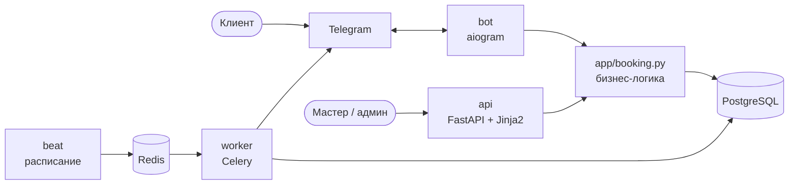

# Barber Booking

Онлайн-запись в барбершоп: клиент записывается через Telegram-бота, мастер отмечает визиты в веб-кабинете, админ управляет мастерами и услугами и смотрит загрузку и выручку.


## Возможности

| Роль | Где | Что может |
|---|---|---|
| Клиент | Telegram-бот | выбрать услугу, мастера, день и свободное время; записаться; посмотреть и отменить свои записи; получить напоминание за 2 часа |
| Мастер | веб-кабинет | видеть своё расписание по дням, отмечать «пришёл» / «не пришёл» |
| Админ | веб-кабинет и API | мастера, их график и аккаунты, услуги и цены; загрузка и выручка за период; ежедневный отчёт в Telegram |

## Стек

FastAPI · SQLAlchemy 2.0 · Alembic · PostgreSQL 17 · Redis · Celery (worker + beat) · aiogram 3 · Jinja2 · JWT (PyJWT) + Argon2 · pytest · Ruff · Docker Compose · GitHub Actions

## Архитектура



Бот и API вызывают одну и ту же бизнес-логику. Celery Beat раз в 5 минут ставит задачу напоминаний, worker отправляет сообщения через Telegram Bot API.

## Интересные места

- **Защита от двойной записи на уровне БД.** Ограничение `EXCLUDE USING gist (barber_id WITH =, tstzrange(start_at, end_at) WITH &&) WHERE status = 'booked'`: PostgreSQL сама не даст записать к мастеру две пересекающиеся записи, даже если запросы придут одновременно. Тест отправляет 10 параллельных запросов на одно время, успешен ровно один (`tests/test_booking.py`).
- **Напоминания без дублей.** Задача помечает записи одним `UPDATE ... WHERE reminder_sent_at IS NULL RETURNING`, поэтому два одновременных запуска не отправят одно напоминание дважды. Временная ошибка Telegram приводит к повтору, «бот заблокирован» — нет.
- **Роли и права.** JWT для API, тот же JWT в `HttpOnly` + `SameSite=Lax` cookie для веб-кабинета. Ограничения мастера (только свои записи, только отметка визита) проверяются в бизнес-логике, а не только в роутере.
- **Цена хранится в записи.** Если услуга подорожает, выручка за прошлые периоды не изменится.

Все решения с альтернативами описаны в [DECISIONS.md](DECISIONS.md).

## Запуск в Docker

```bash
cp .env.example .env        # заполнить TELEGRAM_BOT_TOKEN, JWT_SECRET, пароль БД
docker compose up -d --build
docker compose run --rm api python -m scripts.create_admin admin   # первый админ
docker compose run --rm api python -m scripts.seed                 # демо-данные (необязательно)
```

- Веб-кабинет: http://localhost:8000
- API и Swagger: http://localhost:8000/docs (кнопка **Authorize** — вход по логину и паролю)

Сервисы: `db`, `redis`, `migrate` (применяет миграции и завершается), `api`, `bot`, `worker`, `beat`.

## Локальная разработка (Windows / PowerShell)

```powershell
python -m venv venv
.\venv\Scripts\pip install -r requirements-dev.txt
docker compose up -d db redis
.\venv\Scripts\alembic upgrade head

.\venv\Scripts\uvicorn app.main:app --reload                          # API
.\venv\Scripts\python -m bot                                          # бот
.\venv\Scripts\celery -A app.celery_app worker --pool=solo -l info    # worker (solo — только для Windows)
.\venv\Scripts\celery -A app.celery_app beat -l info                  # расписание
```

Бот в Docker и бот, запущенный локально, с одним токеном мешают друг другу — запускайте что-то одно.

## Тесты и проверки

```powershell
.\venv\Scripts\pytest        # нужен запущенный db: тесты создают базу barber_booking_test
.\venv\Scripts\ruff check .
.\venv\Scripts\ruff format --check .
```

CI (GitHub Actions) на каждый push: линтер, `alembic check` (модели совпадают с миграциями), тесты на PostgreSQL 17, сборка Docker-образа.

## Структура

```
app/
  models.py        таблицы SQLAlchemy
  booking.py       запись, свободные слоты, статусы, правила
  reminders.py     выбор записей для напоминаний
  stats.py         расписание на день, загрузка и выручка
  reports.py       ежедневный отчёт
  tasks.py         задачи Celery
  auth.py          проверка JWT и ролей
  routers/         эндпоинты API
  web.py           веб-кабинет (Jinja2)
bot/               Telegram-бот (aiogram)
alembic/           миграции
scripts/           создание админа, демо-данные
tests/             pytest
```
